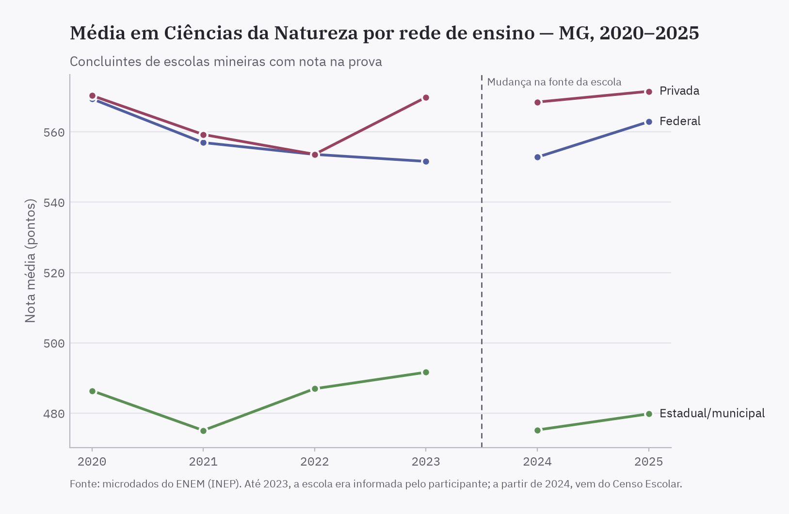
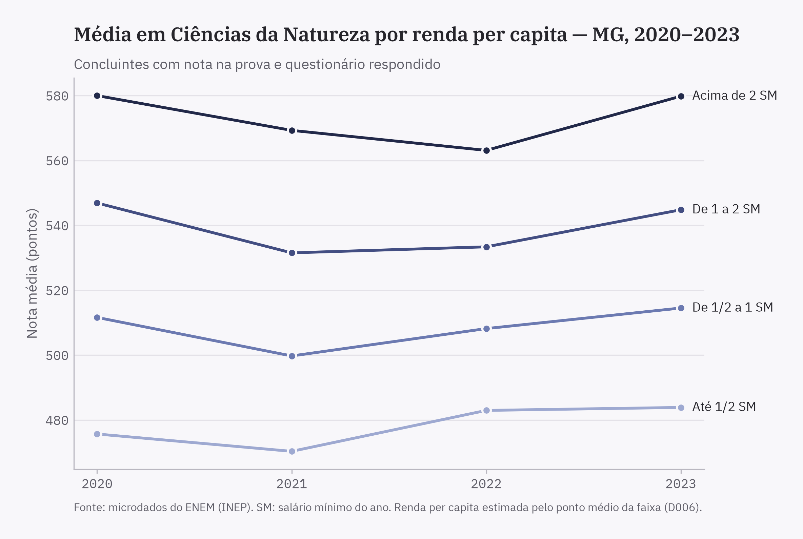

# Gravidade Social

**O peso da origem na nota de Ciências da Natureza do ENEM em Minas Gerais**


> Projeto em desenvolvimento. As etapas de dados (ingestão, limpeza e modelagem
> em SQL) estão concluídas e testadas; a análise exploratória está em andamento.
> Veja o [andamento](#andamento).

## A pergunta

Quanto da nota de Ciências da Natureza de um estudante mineiro é explicado pela
sua origem (renda, escolaridade dos pais, rede de ensino e município)? E em
quais conteúdos essa diferença pesa mais?

O projeto usa os microdados do ENEM de 2020 a 2025, publicados pelo INEP, e
será entregue como análise reproduzível, um app interativo e um texto de
divulgação. As perguntas de pesquisa, com as populações e tabelas de cada uma,
estão em [`docs/perguntas.md`](docs/perguntas.md).

## Por que este projeto

Sou professor de Física na rede estadual de Minas Gerais e mestre em Física.
Depois do segundo dia do ENEM 2026, ouvi de muitos alunos relatos sobre a
dificuldade da prova de Ciências da Natureza. Isso me levou a uma pergunta que
os dados públicos podem ajudar a responder: como o desempenho em Ciências da
Natureza se distribui entre os estudantes mineiros, e o quanto ele se relaciona
com a origem de cada um (renda, família, escola e município)?

O projeto junta as minhas duas formações: a experiência de sala de aula, que
levanta as perguntas, e o rigor da Física, que exige que as respostas venham
dos dados.

## Andamento

| Etapa | Descrição                                    | Status                         |
| ----- | -------------------------------------------- | ------------------------------ |
| 1     | Aquisição, harmonização e ingestão dos dados | ✅ Concluída                   |
| 2     | Limpeza e modelagem em SQL (DuckDB)          | ✅ Concluída                   |
| 3     | Análise exploratória                         | 🔄 Em andamento (Q1 concluída) |
| 4     | Modelagem estatística                        | ⏳ Planejada                   |
| 5     | Raio-X das questões e TRI                    | ⏳ Planejada                   |
| 6     | App interativo (React + Tailwind)            | ⏳ Planejada                   |
| 7     | Relatório e texto de divulgação              | ⏳ Planejada                   |

## Destaques técnicos

- **Pipeline reprodutível:** dos arquivos brutos do INEP a um banco DuckDB com
  dois comandos, sem carregar os CSVs inteiros na memória.
- **Harmonização de seis edições:** cerca de 80 variáveis mapeadas entre
  2020 e 2025, incluindo a mudança de formato dos microdados em 2024
  ([`docs/harmonizacao.csv`](docs/harmonizacao.csv)).
- **Modelo de dados em camadas:** staging (views), tabelas analíticas com as
  populações de cada análise e tabelas agregadas, com as regras centralizadas
  em macros SQL.
- **Testes de dados:** 12 testes que rodam a cada build, incluindo testes de
  reconciliação que reproduzem números verificados à mão. Cada teste foi
  conferido com dados adulterados de propósito, para garantir que consegue
  falhar.
- **Decisões documentadas:** cada escolha metodológica tem contexto,
  alternativas e consequências registradas
  ([`docs/decisoes.md`](docs/decisoes.md), decisões D001 a D008).
- **Investigação de qualidade dos dados:** problemas encontrados nos
  microdados foram investigados antes de qualquer análise
  ([`notebooks/00_pendencias.ipynb`](notebooks/00_pendencias.ipynb)).

## O que os dados revelaram até aqui

Antes de responder às perguntas, foi preciso entender os próprios dados.
Algumas descobertas que mudaram o desenho do projeto:

- **Em 2024 e 2025, nota e perfil socioeconômico não se ligam.** O INEP passou
  a publicar os microdados em tabelas separadas, sem chave comum. Por isso, a
  análise individual (nota × renda e família) fica restrita a 2020–2023 (D002).
- **Quebra de série entre 2023 e 2024.** A escola do participante passou a vir
  do Censo Escolar, e não mais da declaração do participante. Em MG, a
  população com escola identificada mais que dobra de um ano para o outro, o que
  impede comparar diretamente os dois períodos (D002).
- **Escolas pequenas têm o código mascarado.** Escolas com menos de 10
  participantes recebem um código no formato `600xxxxx`; as demais informações
  da escola continuam reais (D004).
- **Cartões-resposta em branco.** Participantes presentes que não marcaram
  nenhuma resposta recebem nota zero. Os casos se concentram em 2023 e foram
  excluídos das análises de nota, mas mantidos no cálculo de presença (D008).

## Arquitetura

```
Microdados do ENEM (INEP, 2020–2025)
        │  scripts/ingest.py — filtra MG, seleciona e renomeia colunas
        ▼
Parquet (data/parquet/)
        │  scripts/build_db.py — executa os arquivos de sql/ em ordem
        ▼
DuckDB (data/enem.duckdb)
   ├── staging    stg_*   views: tipos, recodificações, colunas derivadas
   ├── analítica  fct_*   populações de análise (D002, D007)
   └── agregada   agg_*   resumos por município, rede e escola
        │
        ▼
Notebooks de análise (notebooks/) e, depois, o app (app/)
```

## Stack

- **Dados:** Python, DuckDB (SQL), Parquet, pandas
- **Visualização:** matplotlib, com uma identidade visual própria e paletas
  verificadas para contraste e daltonismo (`src/graficos.py`)
- **App (planejado):** React + Tailwind
- **Versionamento:** Git, com commits semânticos e um PR por etapa

## Estrutura do repositório

```
├── data/          dados (não versionados; ver data/README.md)
├── docs/          decisões, harmonização, especificações, fontes
├── notebooks/     investigações e análises
├── reports/       figuras finais
├── scripts/       ingestão e construção do banco
├── sql/           modelo de dados: staging, analítica, agregada, testes
├── src/           conexão com o banco e funções de gráfico
└── app/           app interativo (planejado)
```

## Como reproduzir

<!-- Confira se os comandos abaixo correspondem ao estado atual do repositório. -->

1. Crie o ambiente e instale as dependências:

   ```bash
   python -m venv venv
   source venv/bin/activate
   pip install -r requirements.txt
   pip install -e .
   ```

2. Baixe os microdados do ENEM de 2020 a 2025 no
   [portal do INEP](https://www.gov.br/inep/pt-br/acesso-a-informacao/dados-abertos/microdados/enem)
   e organize-os conforme [`data/README.md`](data/README.md). A integridade dos
   arquivos pode ser conferida com `sha256sum -c docs/checksums.txt`.

3. Rode a ingestão e construa o banco:

   ```bash
   python scripts/ingest.py
   python scripts/build_db.py
   ```

   O `build_db.py` recria o banco do zero e roda todos os testes.

## Documentação

| Documento                                        | Conteúdo                                    |
| ------------------------------------------------ | ------------------------------------------- |
| [`docs/perguntas.md`](docs/perguntas.md)         | perguntas de pesquisa, populações e tabelas |
| [`docs/decisoes.md`](docs/decisoes.md)           | registro de decisões (D001–D008)            |
| [`docs/harmonizacao.csv`](docs/harmonizacao.csv) | mapeamento das variáveis entre os anos      |
| [`docs/spec-ingestao.md`](docs/spec-ingestao.md) | especificação da ingestão                   |
| [`docs/spec-sql.md`](docs/spec-sql.md)           | especificação do modelo SQL e dos testes    |
| [`docs/fontes.md`](docs/fontes.md)               | origem e procedência dos dados              |

## Primeiros resultados

## Primeiros resultados

A primeira pergunta (Q1) mede o tamanho da diferença nas notas de Ciências da
Natureza entre redes de ensino, faixas de renda per capita e níveis de
escolaridade dos pais.



**Por rede de ensino** ([notebook](notebooks/01_q1_tamanho_da_diferenca.ipynb)):

- A rede estadual/municipal fica bem abaixo das redes federal e privada em
  todos os anos, com diferenças de 60 a 93 pontos, cerca de um
  desvio-padrão das notas.
- A presença na prova também é desigual: em 2021, 69% dos inscritos da rede
  estadual/municipal tiveram nota, contra 92% na federal e 95% na privada.



**Por renda e escolaridade dos pais** ([notebook](notebooks/01b_q1_renda_e_escolaridade.ipynb)):

- A diferença por renda é grande e gradual: a média sobe cerca de 30 pontos a
  cada faixa de renda per capita, e as faixas extremas ficam de 80 a 104
  pontos uma da outra.
- A diferença pela escolaridade dos pais se concentra no ensino superior:
  os passos são pequenos até o médio completo e saltam de 36 a 45 pontos na
  passagem para o superior completo.
- Medidos na mesma escala (_d_ de Cohen), os três fatores mostram diferenças
  grandes, sempre na mesma ordem: renda, rede e escolaridade dos pais.

Essas diferenças descrevem os grupos, e não o efeito de cada fator: renda,
escolaridade dos pais e rede de ensino estão ligadas entre si. Separar esses
fatores é o objetivo das próximas etapas.

## Próximos passos

- Concluir a análise exploratória com o mapa dos municípios (Q2).
- Modelagem estatística: o que mais pesa na nota (Q3) e quem falta à prova (Q4).
- Raio-X das questões de Ciências da Natureza e TRI (Q5 e Q6).
- App interativo em React + Tailwind.

## Uso de IA

Usei o Claude Code como assistente de engenharia: implementação dos scripts e
do SQL a partir das especificações em `docs/`, testes, funções de gráfico e
depuração. As perguntas de pesquisa, a investigação dos dados, as decisões
metodológicas, a interpretação dos resultados e os textos são de minha autoria.

## Autor

**Vítor Fernandes Barra** — Juiz de Fora, MG
[LinkedIn](https://linkedin.com/in/vitorbarra) · [GitHub](https://github.com/Kotige) · vifebarra@outlook.com
